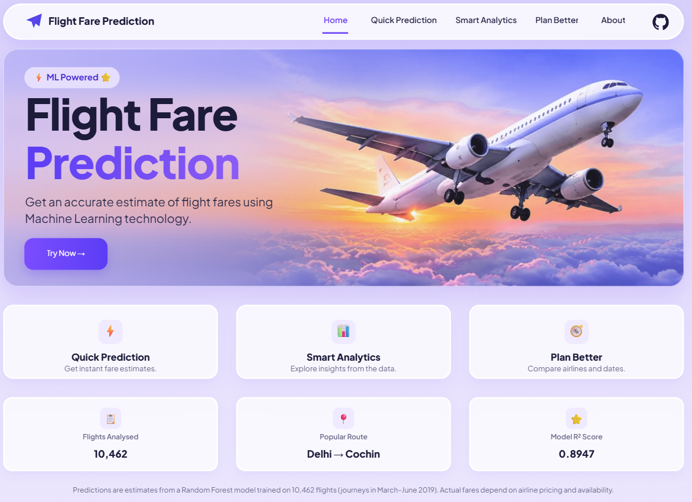
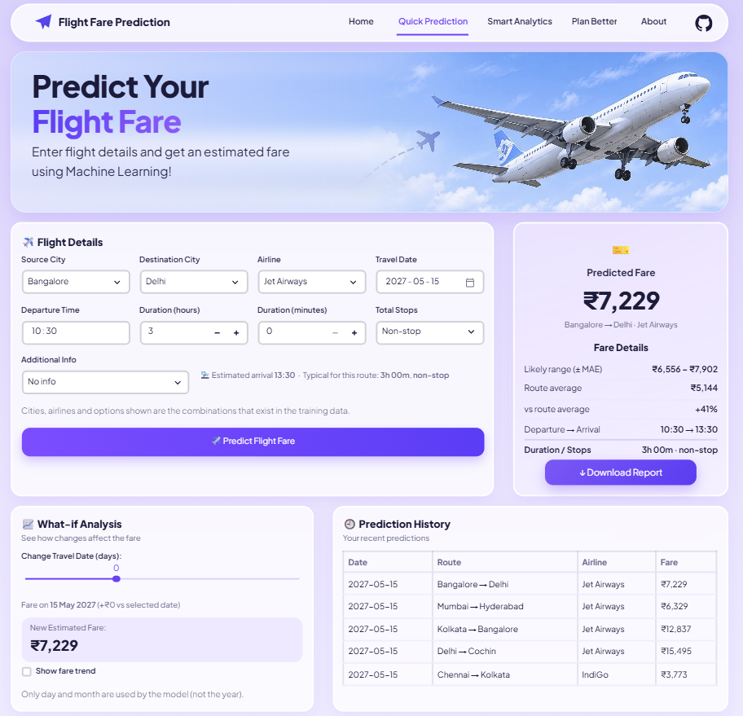
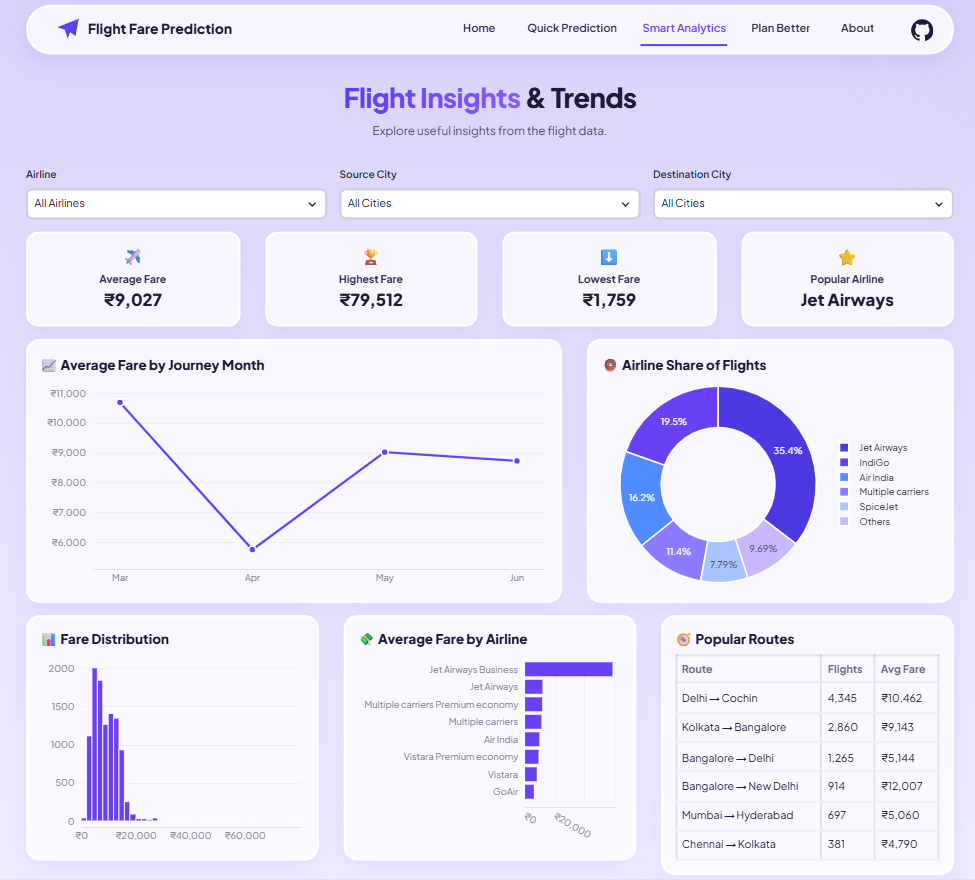
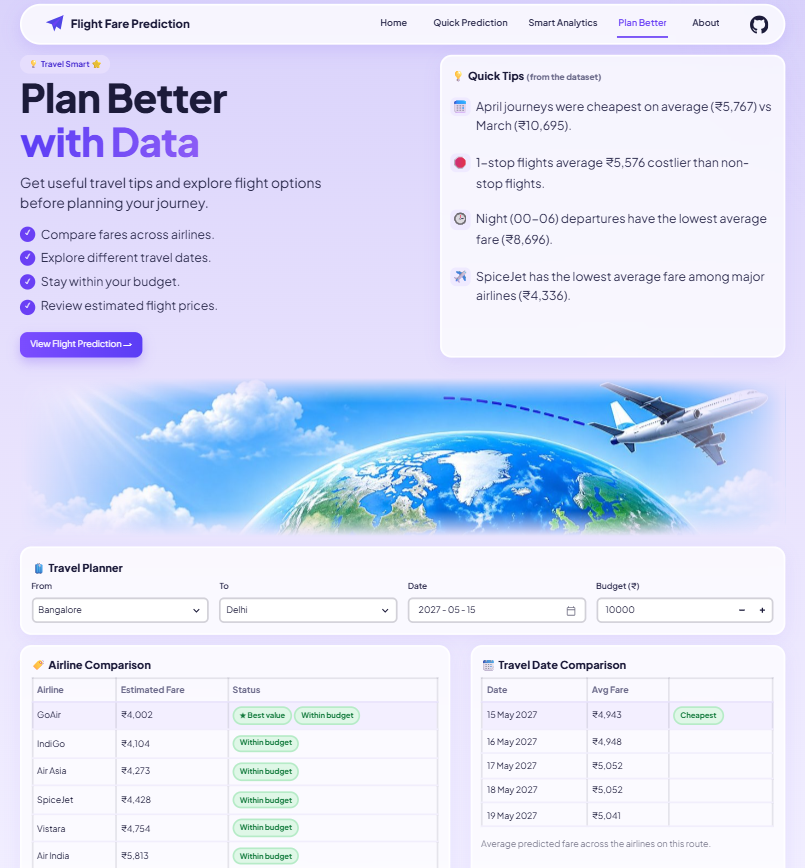

# ✈️ Flight Fare Prediction – Streamlit App

A machine-learning web app that estimates the price of a domestic Indian flight from its route, airline, date, timing and number of stops. It is built on a **Tuned Random Forest** model.

**Developed by Sindhu S**

## Open in Streamlit

🔗 **Live demo:** https://flight-predict-ai.streamlit.app

---

## Screenshots
| Home | Quick Prediction |
|---|---|
|  |  |

| Smart Analytics | Plan Better |
|---|---|
|  |  |


---

## Features
- **Instant fare estimate** for a chosen route, airline, journey date, departure time, duration and number of stops.
- **Predicted fare range** shown next to the estimate, plus the average fare for that route for comparison.
- **What-if analysis:** change the number of stops and see the new estimated fare straight away, with an optional fare-trend view.
- **Prediction history** for the current session, so several searches can be compared.
- **Downloadable PDF report** of the latest prediction (flight details, fare, range, route average, model metrics and session history).
- **Smart Analytics dashboard** with filters (airline, source, destination) and interactive Plotly charts.
- **Plan Better page** with data-driven travel tips and side-by-side airline and travel-date comparisons.
- **Responsive, modern UI:** floating pill navigation bar, glass-style cards and a lavender/purple theme (Plus Jakarta Sans font).
- **Works out of the box:** if the saved model files are missing, the app trains the same model automatically; if the dataset is missing, it shows an upload box.

---

## Pages

| Page | What it does |
|---|---|
| **Home** | Landing page with the project introduction, a *Try Now* button, quick links to the other pages and headline numbers (flights analysed, most popular route, model R²). |
| **Quick Prediction** | Enter the flight details and get the predicted fare. Includes the fare card with *Download Report*, the what-if analysis and the prediction history. |
| **Smart Analytics** | Filter by airline, source and destination and explore average fare by month, airline share of flights, fare distribution, average fare by airline and the most popular routes. Also shows the model's metrics. |
| **Plan Better** | Quick tips drawn from the data (for example which stop-count or departure time is cheapest), an airline comparison and a travel-date comparison for a route you pick. |
| **About** | Describes the project, the dataset, the model and its final performance. |

---

## Dataset
- **File:** `Flight_Fare.xlsx` (flight-fare data of Indian domestic airlines).
- **Size:** about **10,462 flights** after cleaning.
- **Period covered:** journeys between **March and June 2019**.
- **Routes:** 6 source → destination pairs.
- **Main columns:** Airline, Date of Journey, Source, Destination, Route, Departure Time, Arrival Time, Duration, Total Stops, Additional Info and **Price** (the target).

---

## Model performance
Results on the held-out test set (from the notebook):

| Model | MAE | RMSE | R² Score |
|---|---|---|---|
| Linear Regression | 1773.06 | 2656.29 | 0.6616 |
| Decision Tree | 754.84 | 1802.30 | 0.8442 |
| Random Forest | 675.20 | 1489.33 | 0.8936 |
| **Tuned Random Forest (used in the app)** | **672.68** | **1481.72** | **0.8947** |

- **MAE** – on average the prediction is about 673 away from the real fare.
- **RMSE** – a typical error that gives more weight to large mistakes.
- **R²** – the model explains roughly **89 %** of the variation in fares.

MAE and RMSE are shown as plain numbers (not rupees), exactly as reported in the notebook.

---

## How a prediction is made
1. You pick the airline, route, date, departure time, duration and stops.
2. The app calculates the arrival time from the departure time and duration.
3. The inputs are turned into the same 36 features the model was trained on.
4. The Random Forest predicts the fare.
5. The app compares it with the average fare of that route and shows a likely range.
6. The result is added to the session history and can be exported as a PDF.

---

## Sample report
The **Download Report** button creates a PDF for the latest prediction. An example is included here:
[sample_report/flight_fare_prediction_report.pdf](sample_report/flight_fare_prediction_report.pdf)

The report contains: route, airline, journey date, departure and arrival time, duration, stops, predicted fare, fare range, route average, model metrics and the session's prediction history.

---

## Tech stack
| Area | Tools |
|---|---|
| Language | Python 3 |
| Web app | Streamlit |
| Data | pandas, NumPy, openpyxl |
| Machine learning | scikit-learn (Random Forest), joblib |
| Charts | Plotly |
| PDF report | ReportLab |
| Styling | Custom CSS, Plus Jakarta Sans |

---

## Folder structure
```
flight_app/
├── app.py                    # Streamlit UI (5 pages)
├── flight_utils.py           # cleaning, features, model + prediction (same steps as the notebook)
├── requirements.txt          # Python packages
├── .streamlit/config.toml    # purple theme
├── sample_report/            # example PDF created by the Download Report button
├── screenshots/              # images used in this README
├── assets/                   # banner photos (home_sky.webp, predict_sky.webp) + plan_hero.jpg (+ older fallbacks)
├── Flight_Fare.xlsx          # dataset (required)
├── flight_price_model.pkl    # optional: model saved by the notebook
└── feature_columns.pkl       # optional: feature order saved by the notebook
```

---

## Limitations
- The model only knows journeys from **March to June 2019** and the **6 routes** in the dataset, so the app offers only those routes and airlines and shows a warning if the chosen month is outside that range.
- Predictions are **estimates** based on historical data. Real fares also depend on demand, seat availability, festivals, fuel prices and how early you book, none of which are in the dataset.
- The model does not include the booking date, so it cannot capture how fares change as the departure date gets closer.

---

## Future improvements
- Train on more recent and larger data covering more routes and months.
- Add booking-lead-time and seasonal features.
- Try gradient-boosting models (XGBoost, LightGBM) and compare them with the Random Forest.
- Add live fare comparison and price-alert features.
- Deploy the app online (for example on Streamlit Community Cloud).

---

Developed by **Sindhu S** 

[GitHub](https://github.com/sindhus56) · [LinkedIn](https://www.linkedin.com/in/sindhu-s56/) · sindhus5656@gmail.com
